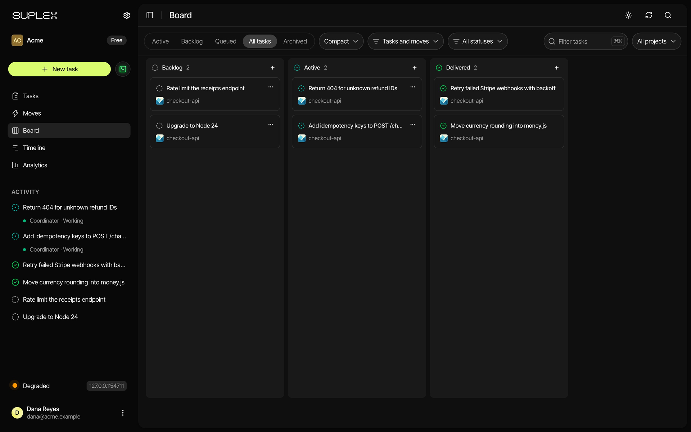
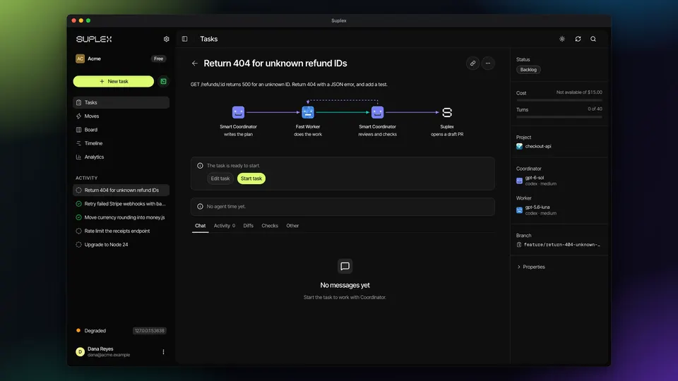
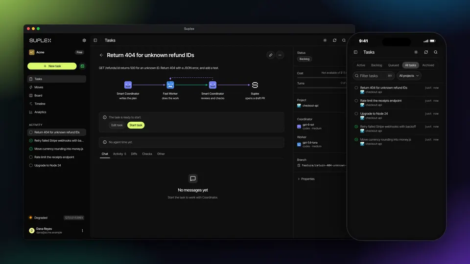
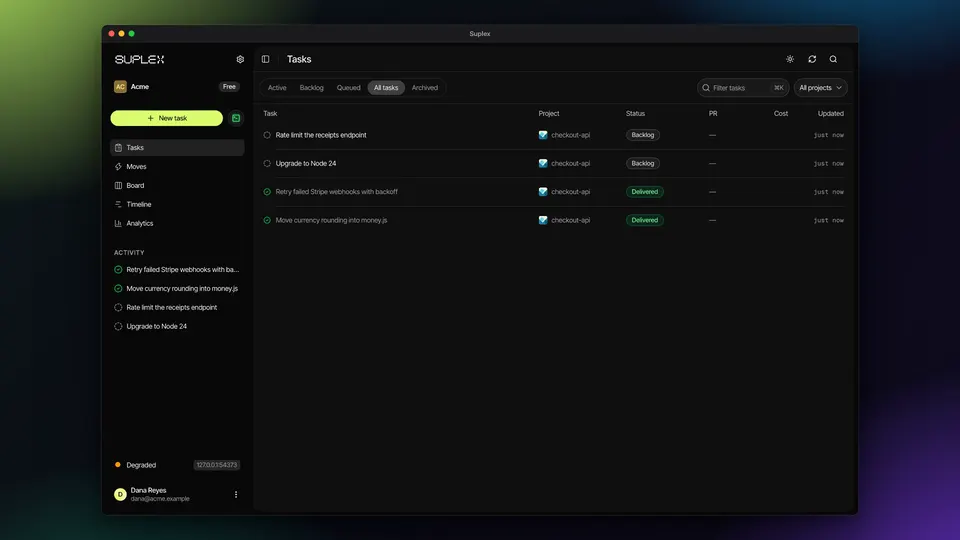
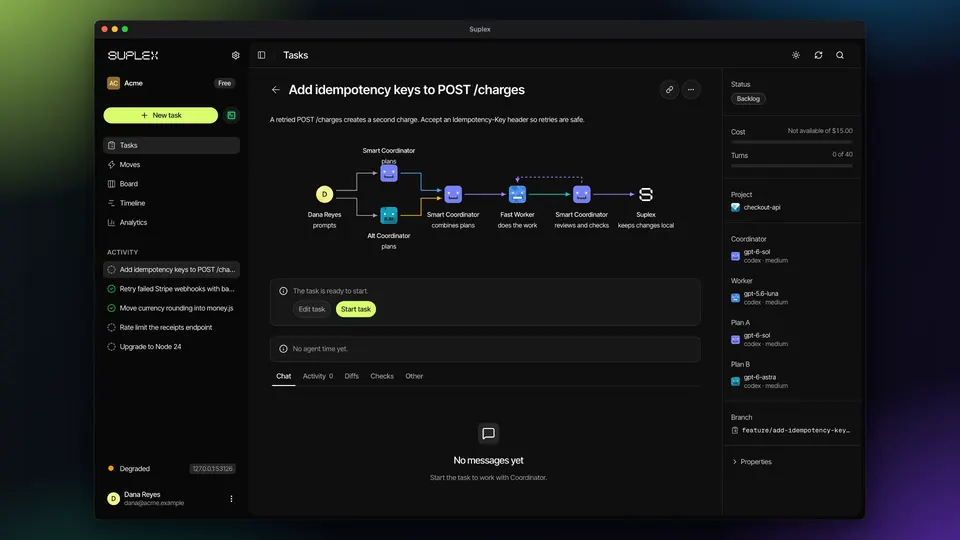
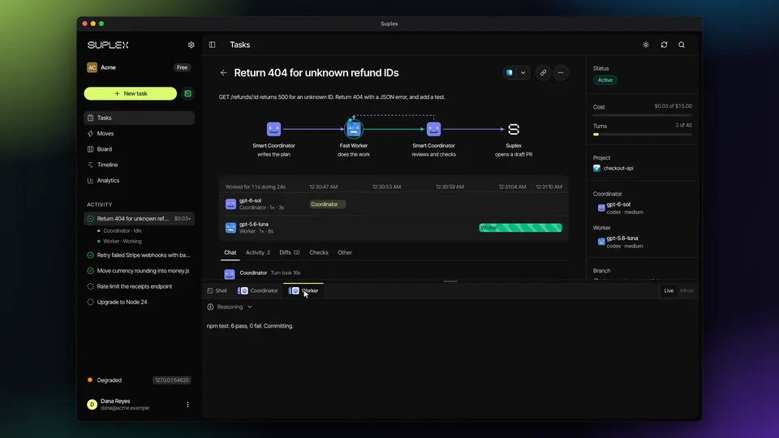
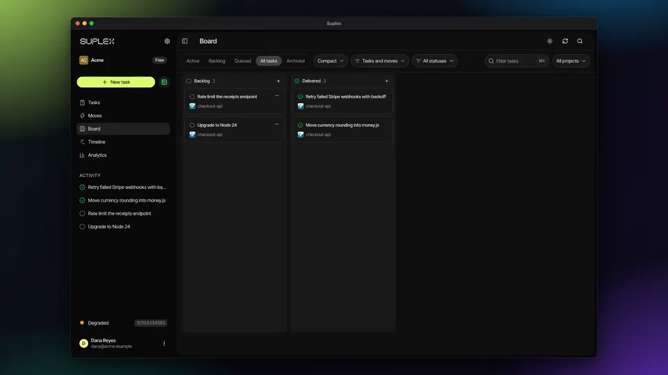
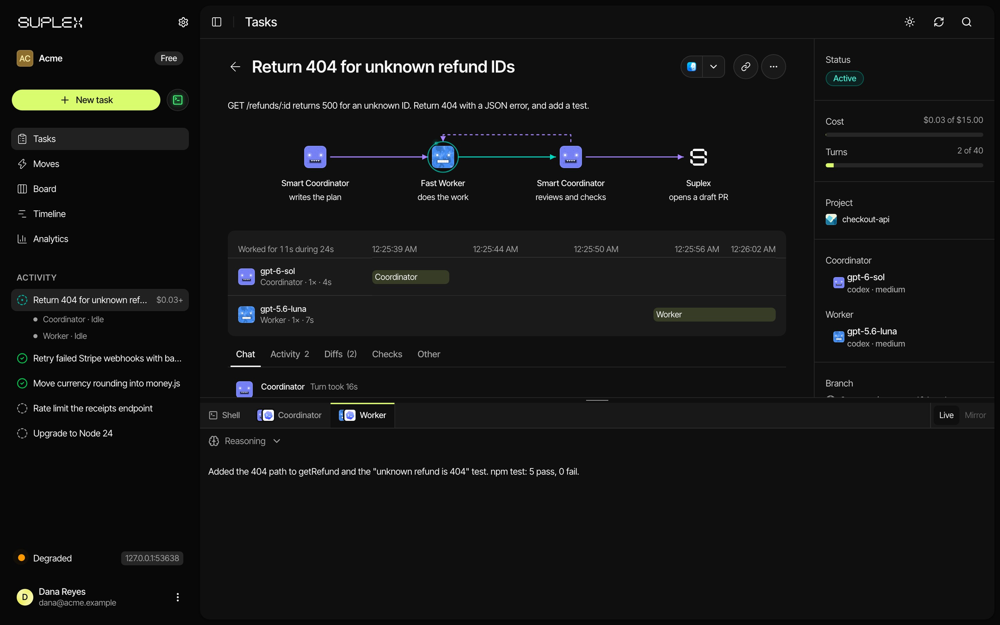
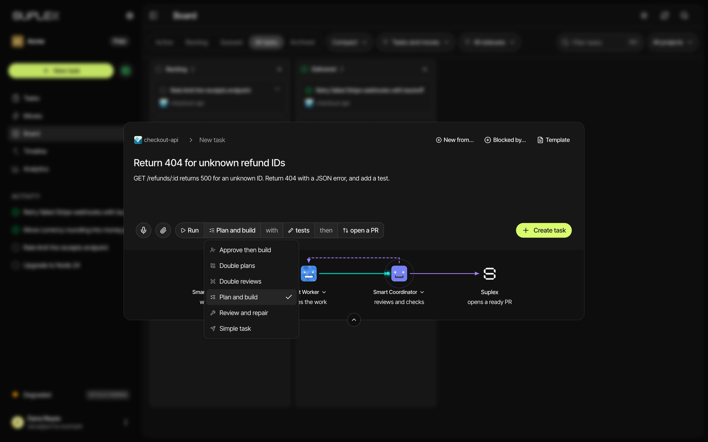
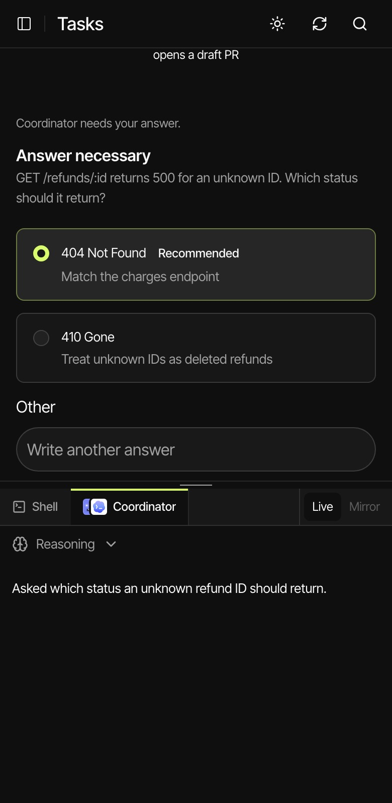

<h1 align="center">Suplex</h1>



<p align="center">
 <strong>Your agents do the work. Suplex runs the workflow.</strong>
</p>

<p align="center">
 <a href="docs/product.md">Product guide</a> •
 <a href="docs/architecture/README.md">Architecture</a> •
 <a href="docs/">Docs</a> •
 <a href="docs/install.md">Install</a> •
 <a href="docs/agents/machine-discovery.md">Agent discovery</a>
</p>

<p align="center">
 <a href="https://github.com/meiji-industries/suplex/actions/workflows/ci.yml"></a>
 <a href="LICENSE"></a>
 
 
 
 
 
 
 
 
 <a href="https://suplex.sh"></a>
</p>

> **Under active development.** Suplex ships versioned releases while the product grows.
> It is for owner-controlled repositories and trusted local tools. Coordinator's
> read-only policy and Worker's Git command guard are native tool policies, not an
> operating-system sandbox. Projects do not isolate one client from another on the same host.

<!-- Recorded on an isolated host with a demo company (Acme) and a scripted stand-in
for the agents. Keep each animation under 10 MB. -->
<table>
  <tr>
    <td width="50%" valign="top">
      
      <br><b>Start a task in one sentence</b>
      <br><sub>Write what you want, pick a workflow, and Suplex makes the worktree, branch, and agents.</sub>
    </td>
    <td width="50%" valign="top">
      
      <br><b>Coordinator plans, Worker builds</b>
      <br><sub>No copy and paste between agents. Coordinator delegates, reviews, and asks Worker for repairs.</sub>
    </td>
  </tr>
  <tr>
    <td width="50%" valign="top">
      
      <br><b>Answer from your phone</b>
      <br><sub>An agent's question waits on every device. Web Push tells you when one arrives.</sub>
    </td>
    <td width="50%" valign="top">
      
      <br><b>Repair a pull request until it merges</b>
      <br><sub>Review and repair rates a pull request, sends the findings to Worker, and merges at 9/10 or more.</sub>
    </td>
  </tr>
  <tr>
    <td width="50%" valign="top">
      
      <br><b>Two independent plans, one build</b>
      <br><sub>Double plans asks two agents for separate plans. Coordinator combines the best of both before Worker starts.</sub>
    </td>
    <td width="50%" valign="top">
      
      <br><b>Edit it yourself, Suplex continues</b>
      <br><sub>Change the code, push, or merge by hand. Suplex keeps your work and continues from the actual state.</sub>
    </td>
  </tr>
  <tr>
    <td width="50%" valign="top">
      
      <br><b>Save a prompt, run it in one click</b>
      <br><sub>Moves are saved prompts and scripts with inputs. Each run opens your agent or script in a fresh worktree.</sub>
    </td>
    <td width="50%" valign="top">
      
      <br><b>A host shell, one keystroke away</b>
      <br><sub>Press Ctrl+` on any page for a login shell on the host. Close it and it keeps running.</sub>
    </td>
  </tr>
</table>

# What is Suplex?

Suplex coordinates software-development tasks through the coding agents, Git,
and repository services you already use. It reduces the work of copying plans
between agents, brokering revisions, and shepherding branches and checks through
delivery.

A Coordinator plans and reviews. A Worker implements in a task worktree. Suplex
is a copilot: you can edit code, change a branch, or merge a pull request
yourself. Suplex observes what happened, keeps your work, and continues from the
actual state.

## By hand vs. Suplex

|  | By hand | Suplex |
| --- | --- | --- |
| **Plan handoff** | ⚠️ You copy the plan from one agent to the next | ✅ Coordinator delegates to Worker |
| **Revisions** | ⚠️ You relay review comments back and forth | ✅ Coordinator reviews and asks Worker for repairs |
| **Independent plans** | ❌ You run two agents and merge the plans yourself | ✅ Double plans combines Plan A and Plan B |
| **Parallel tasks** | ⚠️ You create and track worktrees yourself | ✅ One worktree and branch per task |
| **Task order** | ❌ You remember which task waits for which | ✅ Queued tasks wait for prerequisites |
| **CI and conflicts** | ⚠️ You watch checks and rebase | ✅ Agents can repair code and integration conflicts |
| **Your agents and accounts** | ✅ Yes | ✅ Yes, through each tool's own sign-in |
| **Direct edits and merges** | ✅ Yes | ✅ Yes, Suplex observes them and continues |
| **Input alerts on a phone** | ❌ No | ✅ Web Push when a task needs input |
| **Host isolation between clients** | ❌ No | ❌ No, use owner-controlled repositories and trusted tools |

# Install

Download the app from [suplex.sh](https://suplex.sh), or use a direct link:

| Platform | Download | Notes |
| --- | --- | --- |
| macOS, Apple silicon | [suplex.sh/download?platform=macos-arm64](https://suplex.sh/download?platform=macos-arm64) | Choose **Run locally**. The app installs Herdr, and Apple's developer tools if Git is missing. |
| macOS, Intel | [suplex.sh/download?platform=macos-x64](https://suplex.sh/download?platform=macos-x64) | Same as Apple silicon. |
| Linux x64, deb or rpm | [deb](https://suplex.sh/download?platform=linux-desktop-x64&format=deb), [rpm](https://suplex.sh/download?platform=linux-desktop-x64&format=rpm) | Install Git first. Data stays in `~/.local/share/Suplex`. |
| Linux Arm64, deb or rpm | [deb](https://suplex.sh/download?platform=linux-desktop-arm64&format=deb), [rpm](https://suplex.sh/download?platform=linux-desktop-arm64&format=rpm) | Same as Linux x64. |
| Windows x64 or Arm64 | [x64](https://suplex.sh/download?platform=windows-x64), [Arm64](https://suplex.sh/download?platform=windows-arm64) | Connects to a Suplex host on another computer. It cannot run a host itself. |

On Windows, you can also run this in PowerShell:

```powershell
irm https://suplex.sh/install.ps1 | iex
```

Each agent tool owns its own sign-in. Sign in to OpenCode, Claude Code, Devin CLI,
Codex CLI, Pi, or OMP as the OS user that runs Suplex. The [install guide](docs/install.md)
covers providers, network access, the desktop app, lifecycle commands, and telemetry.

## Set up an installation

The desktop app ships the native server and web assets. On first open, an
administrator logs in to a Suplex account. Then you configure companies,
projects, and native profiles in the web application. Project creation copies a
GitHub repository into the configured repository root. To run a host from a
checkout, or to set up Tailscale or local-only access, read
[set up an installation](docs/install.md#set-up-an-installation).

### Linux host

To run Suplex on a new cloud server, run this on your own computer (macOS or Linux):

```sh
curl -fsSL https://suplex.sh/bootstrap.sh | sh
```

It installs `suplex-bootstrap` and starts its wizard, which creates or connects
to the server, sets up the host, and prints a login link. See
[apps/bootstrap](apps/bootstrap/README.md).

To set up a host by hand, start Suplex as a dedicated non-root user. That user owns the data directory,
repository roots, worktree roots, Herdr, and agent tool installs. The Linux
installer and the `suplex up`, `restart`, `down`, and `serve` commands refuse to
run as root. Read [Linux host](docs/install.md#linux-host) for the systemd
settings and the checkout install commands.

## Back up and restore

Admins create, download, and restore backups in **Settings > Backups**. On a
Linux host, the `suplex` command does the same:

```sh
suplex backup /path/to/suplex-backup.tar.gz
suplex verify-backup /path/to/suplex-backup.tar.gz
suplex restore /path/to/suplex-backup.tar.gz /path/to/empty-restore-directory
```

Backups exclude provider credentials. Restore requires an empty destination.
Read [back up and restore](docs/install.md#back-up-and-restore) for what a
backup holds and what it cannot restore.

# How it works

Suplex runs a native API and task host beside a SQLite database. Each system
owns its own facts:

| Owner | Authoritative state |
| --- | --- |
| Suplex | Task objective, configuration, start and cancel intent, questions, session assignment, prompt dispatch ownership |
| Native agent provider | Sessions, admitted messages, tool execution, and turn results |
| Git | Worktrees, branches, commits, and uncommitted changes |
| GitHub | Remote branches, pull requests, checks, reviews, and merges |
| Herdr | The visible attachment to a native session |

Database records keep Suplex-owned intent and correlate native observations.
Delivery decisions read current Git and repository-provider state. A restart
does not discard the worktree or replay an admitted prompt.

## Coordinator and Worker



Coordinator investigates and specifies a task, delegates implementation to
Worker, reviews the result, and requests delivery operations. Worker edits and
verifies. Each role can use a different agent profile.

Coordinator delegates work and ends its turn. Results wake the same session.
Advisors (Reviewer, Plan A, Plan B, and Rater) are read-only and report to Coordinator. The code and wire
fields call Coordinator `root`. That is the same role, not another agent.

## Six workflows



- **Plan and build**: Coordinator plans, Worker implements, Coordinator reviews.
- **Simple task**: Worker chooses the approach from the task instructions. Coordinator reviews the result.
- **Double reviews**: a read-only Reviewer checks the current change before delivery.
- **Double plans**: Plan A and Plan B produce independent plans. Coordinator combines them before implementation.
- **Review and repair**: a Rater reviews an open pull request and Worker repairs it until the change earns at least 9 with no blocking findings.
- **Approve then build**: Coordinator plans and you approve the plan or request changes before the first build.

Named presets select a built-in workflow with agent, delivery, and check
defaults. Project instructions and task descriptions customize the work. There
is no arbitrary step-graph editor. Read
[workflows and templates](docs/architecture/workflows-and-templates.md).

## Parallel worktrees and dependency-aware chains

Each task gets its own Git worktree and branch, so independent tasks progress in
parallel. Double plans gives Plan A and Plan B separate slots. Worktrees
separate files. They do not separate host credentials or shared services.

Queued tasks wait for prerequisite tasks or GitHub pull requests. Backlog tasks
do not start automatically. A pull request prerequisite must merge before the
dependent task starts. Read
[parallel work and dependencies](docs/architecture/parallel-work-and-dependencies.md).

## Delivery targets

Each task has a delivery target: local worktree, remote branch, draft pull
request, ready pull request, or merged pull request. GitHub supports all five.
Bitbucket Cloud supports the first three.

Coordinator can request a push, pull request creation, review readiness, or an
exact-head merge. Suplex observes CI. Agents can repair code and integration
conflicts. GitHub enforces its own merge policy. A completed task means its
target was reached. It does not mean a production deployment.

A delivery target guides agent work. It does not limit what you do. An edit,
commit, push, or matching pull request that you make outside Suplex is observed
and kept.

## Moves, templates, and triggers

- **Moves** are project-scoped saved prompts and scripts with typed inputs. A
  prompt opens the Worker agent (Claude Code or Codex) in a host terminal at a
  fresh worktree. A script runs in that terminal. A move can also start a Pull
  request repair task for each open pull request you do not exclude. Moves have
  no schedule.
- **Task templates** save task configuration for a project. You can create one
  from an existing task.
- **GitHub triggers** create tasks from labelled open pull requests with a
  selected workflow. Suplex checks for newly labelled pull requests every 15
  seconds. Each rule can ignore, review, or deliver draft and ready pull
  requests separately. This is a pull request label trigger, not a general
  GitHub event system.
- **Quick shell** opens a persistent login shell on the host for an admin.
  Press Ctrl+` or use the sidebar button.

## Phone access, push, and dictation

<p align="center"></p>

The web app installs to the Home Screen from any host that serves it over HTTPS
or loopback. Web Push tells the task creator and admins when a task needs input.
It works on iOS and iPadOS 16.4 or later from the Home Screen app, and in Chrome,
Edge, and Firefox on Android and desktop. The desktop app and the iOS and Android
shells do not receive Web Push.

In a browser with speech recognition, a microphone button appends spoken text to
the Coordinator message and the New Task description. The browser vendor, not
Suplex, processes the audio.

## Paired agents and MCP

A paired external agent can create and follow tasks within its grants. A bot can
supply meeting notes as task input. Suplex does not capture or transcribe meetings.

Suplex serves an HTTP MCP endpoint at `/mcp` with OAuth 2.1 browser approval,
and an advanced local stdio bridge. MCP task tools do not expose delivery or
merge commands. An agent that never opens the web application starts at
[machine discovery and the operator handoff](docs/agents/machine-discovery.md).
Suplex serves `/llms.txt`, `/.well-known/suplex/api-catalog.json`, and
`/.well-known/suplex/agent-skills.json` without authentication. That document
also holds the operator handoff: issue, rotate, and revoke a pairing, restrict
project grants, and verify an agent integration after an upgrade. See the
[MCP guide](docs/agent-mcp.md) and the [agent API guide](docs/agent-api.md).

# Integrations

| Integration | What Suplex does | Limits |
| --- | --- | --- |
| OpenCode, Claude Code, Devin CLI, Codex CLI, Pi, OMP | Runs each as a native runtime for Coordinator, Worker, and Advisors. | Each tool owns its sign-in. Login detection does not prove model access. Other tools need a runtime integration. |
| Git | Repository and task worktree operations. | Git transport authentication is separate from repository API credentials. |
| GitHub | Repository onboarding, issues, pull requests, check observation, delivery, and pull request label triggers. | Repository permissions, required checks, reviews, and merge policy still apply. |
| Bitbucket Cloud | Repository and pull request API access. Delivery to a local worktree, remote branch, or draft pull request. | Ready and merged targets are not available. |
| Jira Cloud | Reads issue context and publishes task artifacts and comments. | Publication does not change issue status, Sprint, or Fix Version. |
| Linear | Searches and reads issues for one team and publishes comments and screenshot uploads. | Uses a personal API key. Publication does not change issue state. |
| MCP clients | Connect to Suplex over HTTP MCP or a local stdio bridge to use task tools. | Task tools do not expose delivery or merge commands. |
| Project MCP tools | Grants exact MCP tools to agents by role. | Claude Code agents only. |
| Herdr | Shows native sessions in task panes. | A missing pane does not block task progress. |

The [product guide](docs/product.md#integrations) lists each implementation and boundary.

# Contributing from source

Read [AGENTS.md](AGENTS.md) before you change code. It holds the engineering
rules, the UI stack, and where new code goes. Install [mise](https://mise.jdx.dev),
then run:

```sh
mise run worktree
mise run dev:status
mise run dev
```

Reuse a stack that `dev:status` reports. Run `pnpm check` before you send a
change. [Development](docs/development.md) covers build caches, desktop app
commands, and the full verification suite.

| Path | What it holds |
| --- | --- |
| `apps/server` | The `suplex` crate: the native host, the hosted `suplex.sh` service, the MCP bridges, and the CLI. |
| `apps/web` | The React web application. |
| `apps/desktop` | The Tauri 2 desktop app. |
| `apps/mobile` | The iOS and Android shells. |
| `apps/bootstrap` | The `suplex-bootstrap` cloud server wizard. |
| `apps/server/migrations` | Timestamped SQL migrations. Read [the migration guide](docs/database-migrations.md). |
| `apps/server/skills/suplex` | The agent skill and client for paired external agents. |
| `tests` | Cross-app interop, parity, migration, and browser tests. |
| `docs` | Product guide, architecture, ADRs, and operator guides. |

[CONTEXT.md](CONTEXT.md) defines the terms. [Current architecture](docs/architecture/README.md)
records how the system works. [Architecture decisions](docs/adr/) explain why.

Outside contributions need a signed contributor license agreement. Read
[CONTRIBUTING.md](CONTRIBUTING.md) before you open a pull request.

# Status and roadmap

Suplex ships versioned releases from `main`. Planned work and open questions
live in [issues](https://github.com/meiji-industries/suplex/issues),
[proposals](docs/proposals.md), and [unresolved work](docs/architecture/unknowns.md).
Proposals are ideas, not commitments.

# License

Suplex is source-available under the [Elastic License 2.0](LICENSE). You can
use, copy, change, and redistribute it. You cannot offer it to others as a
hosted or managed service, or remove or get around its license key
functions. Third-party material keeps its own license; see
[THIRD_PARTY_NOTICES.md](THIRD_PARTY_NOTICES.md).
This summary is not the license. The [LICENSE](LICENSE) file governs.
