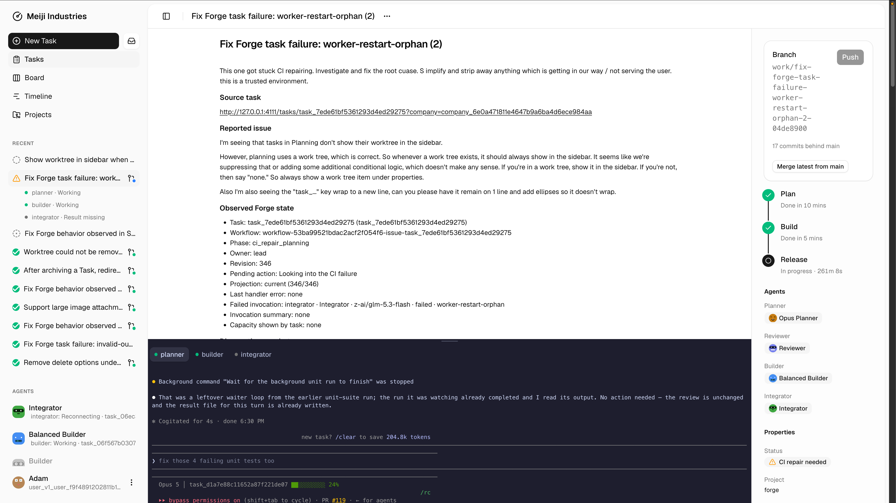
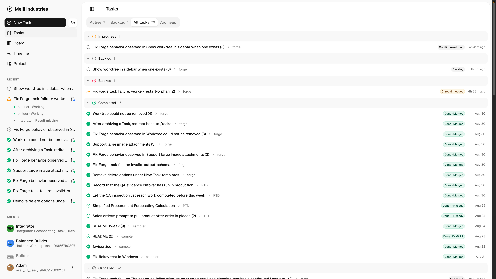
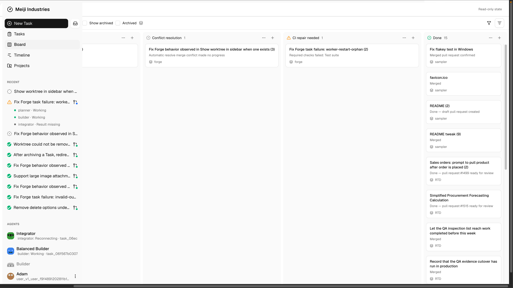
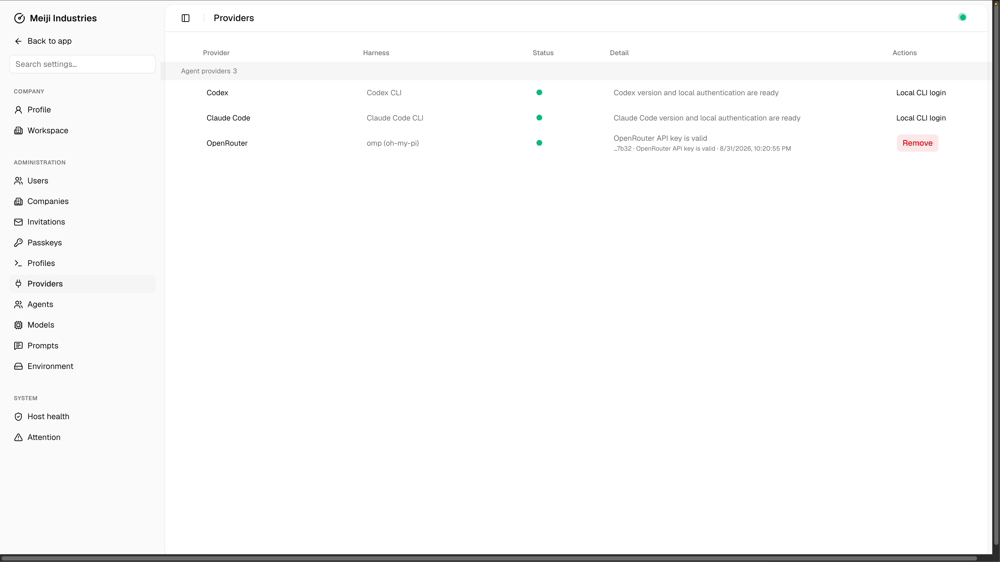

# Forge

Forge is the working name for an operating system for an agent-powered software
agency. It gives an established independent developer one place to run client
projects, specialist agents, code, and delivery without turning the work into a
click-heavy dashboard.

Forge is local-first and Tailscale-only: it runs beside the repositories and
developer tools that do the work, while the web application provides a clear,
shared operating surface. It is designed to feel capable and straightforward:
close to the work, explicit about what is happening, and warm without being
ornamental.



## What Forge does

Forge starts with a repository-backed project. You connect the local providers
and agent profiles you want to use, create a task with the relevant context,
and move work through a durable delivery process. Tasks can be managed in an
index, Kanban board, or timeline; each represents the same underlying work,
not a separate planning system.

The normal path is:

```text
project + repository → task → plan → review → build → integration
                         → checks + CI → pull request → merge → complete
```

Planner, reviewer, builder/developer, and integrator roles keep judgment and
execution visible. Forge can also host first-class Hermes agents that bring in
outside context and create work when that context becomes actionable. The task
detail is the central work area: it brings together chat, live agent and Herdr
panes, plans, activity, diffs, checks, pull-request and delivery status, and a
property rail rather than scattering that evidence across tools.





## Configure an agency, not just a task board

Forge configuration covers companies and workspaces, users and passkeys,
projects, agents and their capacity, providers, model catalogues, cascading
prompts, runtime environment settings, and host health. Profiles select an
agent provider, model, reasoning level, and service priority so a role uses a
deliberate setup instead of an ad-hoc model choice.

Today, Forge supports local Codex and Claude Code sessions, plus OpenRouter
models through `omp`. Provider logins stay on the host; OpenRouter is the
exception where Forge stores the local API key securely and excludes it from
backups. See [Product guide](docs/product.md) for the product model, current
screens, and the next design priorities.



## Product guide

Read [docs/product.md](docs/product.md) for the intended user, the current
Forge workflow, role and configuration model, screen map, and the design work
that comes next. The terms used in the codebase are defined in
[CONTEXT.md](CONTEXT.md); durable technical decisions live in [docs/adr](docs/adr).

The health surface uses a source-owned shadcn/Rhea-style component layer with
Base UI primitives, Tailwind v4 design tokens, and a dense desktop application
layout inspired by Linear and Paperclip.

## Architecture

### Processes and state

Forge runs as two locally supervised Node processes that share one SQLite database and one on-disk artifact store; the in-process engine in `src/engine` owns workflow state in SQLite. `forge start` spawns both, records their verified identities in `.forge/data/runtime/owned-processes.json`, and optionally fronts the server with Tailscale Serve.

```text
              tailnet (Tailscale Serve HTTPS, or direct Tailscale HTTP)
                                      │
                                      ▼
          ┌─────────────────────────────────────────────────┐
          │ forge server (src/server.ts)                    │
          │ Fastify API, passkey auth, React UI, /health    │
          └───────┬─────────────────────────────┬───────────┘
     reads read models,             submits engine commands
     serves evidence                and reads state
                  │                             │
                  ▼                             ▼
          ┌───────────────┐          ┌──────────────────────────┐
          │ SQLite (WAL)  │◀─────────│ forge worker             │
          │ engine state, │  writes  │ (src/worker.ts)          │
          │ projections,  │          │ engine loop, activities  │
          │ capacity,     │          └───┬──────────┬───────┬───┘
          │ leases, auth  │              │          │       │
          └───────▲───────┘        Codex CLI   developer   gh CLI
                  │ activities write  (Lead)      supervisor  (GitHub)
          ┌───────┴───────┐                       + worktrees
          │ artifact store│
          │ briefs, plans,│
          │ evidence      │
          └───────────────┘
```

Engine commands carry only small IDs, hashes, summaries, and artifact references. Plans, reviews, transcripts, briefs, and delivery evidence live as immutable, hash-verified files in the company-scoped artifact store. GitHub CLI and Codex use host local sessions. OpenRouter requires `omp` on PATH at version 18.0.0 or later, or `FORGE_OMP_COMMAND`, and an API key in Settings > Providers. Add OpenRouter `vendor/model` IDs in Settings > Models.

### The durable issue workflow and its read models

Each issue runs in the in-process engine at `src/engine/workflows.ts`. Every human action in the UI is an engine command. The engine validates each command against the allowed commands, advances the state revision, writes snapshots to `forge_workflow_snapshots`, and records commands in `forge_engine_commands`. The kanban board, issue timeline, and action-required badges are read models derived from those projections. They are never edited directly and can be rebuilt from engine history. The engine raises typed blockers with evidence pointers, and the projection layer derives the ledger row from them.

```text
  browser action                engine command             activity
  POST /tasks/<id>/… ─────────▶ issueWorkflow ────────────▶ projectIssueState
                                revision n+1                     │
        ▲                                                        ▼
        │              forge_issue_projections · forge_issue_timeline
        │              forge_attention_items (action-required ledger)
        └────────────────── read by the API and UI ◀─────────────┘
```

### Issue lifecycle

An issue moves through explicit phases (`src/issue-phases.ts`); the workflow exposes only the legal commands for the current phase, so the board renders buttons instead of free-form transitions. The diagram shows the main path; short hand-off phases such as `ready_for_development`, `delivery_ready`, `delivery_reviewed`, and `ready_reconciliation` are elided.

```text
  backlog
     │ member starts planning
     ▼
  planning ──▶ supplemental_review ──▶ plan_consolidation
     │           (optional, one independent review per plan revision)
     ▼
  approval ──── material plans wait for an auditable member decision;
     │          routine plans proceed automatically
     ▼
  development ◀───────────────────────────────┐
     │ Developer delivers an exact commit     │ Developer executes the
     ▼                                        │ Lead-authored repair plan
  reviewing_delivery ──▶ repair_required ─────┘
     │ Lead approves the exact revision
     ▼
  releasing ──▶ ci_waiting ──▶ final_review ──▶ accepted ──▶ done
     ▲               │                                 (authoritative external
     │               ▼                                  GitHub merge event)
  merge_conflict_*                ci_repair_*
  (target base advanced: forward  (Lead plans the fix, Developer
   merge with a Lead-planned      repairs, the full verification
   conflict resolution)           matrix reruns)
```

Blockers are typed and owned: `blocked` and `delivery_blocked` name who must act (a member decision, a capacity retry, a provider sign-in) and surface as attention items. `cancelled` and `failed` are terminal; the Continue action creates a successor execution with a fresh Lead session and worktree while the original remains immutable history.

### Lead and Developer

Judgment and execution are separated. The Lead owns one resumable Codex session per issue for planning, delivery review, repair planning, and merge-conflict planning; the Developer owns a separate session that implements the exact final plan. A Developer that finds repository evidence contradicting the plan stops and returns it to the Lead rather than improvising, and it never publishes branches or calls providers — release automation and `gh` operations run deterministically in the worker.

Developer turns are isolated and crash-safe. Forge records the durable turn and
result claim in SQLite, then drives the persistent interactive Developer
session through Herdr. A worker, Herdr-server, or pane restart recreates a
pane with `codex resume` against that same session rather than relying on a
PID:

```text
  issueWorkflow
     │ activity: runDeveloperExecutionSupervised
     ▼
  durable turn + result claim (SQLite) ──▶ Herdr Developer pane
  session ID, prompt hash, offset             │ interactive Codex session
  and completion markers                      ▼
                                        Codex in the issue worktree
                                   ~/forge/worktrees/<owner>/<repository>/…
                                                    │
                                                    ▼
                                      schema-valid result file + rollout marker
                                                    │ claimed exactly once
                                                    ▼
                            workflow records the exact commit + tree (delivery_ready)
```

Every issue gets its own Git worktree and branch; parallel issues on the same repository never share a working directory. When the target base advances, Forge forward-merges at explicit gates instead of rebasing, and a conflict blocks for a Lead-planned resolution.

### Capacity lanes

Agent turns are admitted through configurable capacity lanes rather than run unbounded. A lane admits independent issues in parallel but never concurrent turns for the same issue-role session or worktree; the queue is FIFO and shared across companies. Provider rate limits retry durably; an exhausted policy becomes an action-required blocker instead of a silent fallback.

```text
  turn needed ──▶ requestCapacity ──▶ lane queue (FIFO)
                                          │ slot free
                                          ▼
                                     active turn ──▶ finalize
                                          │ provider rate limit
                                          ▼
                              rate_limited (durable retry)
                                          │ policy exhausted
                                          ▼
                              action-required blocker (retry or cancel)
```

The ubiquitous language behind these concepts — issue worktree, capacity lane, material plan decision, supplemental review, direct release, and the rest — is defined in `CONTEXT.md`, and the decisions behind capacity lanes, the owner-controlled pilot, provider polling, and passkey login are recorded in `docs/adr/`.

## Develop locally

```sh
mise run worktree
mise run dev
# From another terminal, stop every Forge development process for this checkout.
mise run down
```

The worktree task installs the pinned tools and dependencies and is also used by Conductor setup. The dev server signs loopback requests in as a development administrator and, when the local database is empty, seeds a Development company, default Codex profile, and draft project for the current checkout. Auto-login is never enabled for the Tailscale address.

## Run in production

Forge runs its API and workers locally. Install dependencies, build the application, and run setup:

```sh
corepack enable
pnpm install --frozen-lockfile
pnpm run build
pnpm run forge setup
pnpm run forge start
```

The wizard offers Tailscale Serve HTTPS (recommended) or direct Tailscale HTTP, discovers the local MagicDNS hostname when Tailscale is available, and upserts only Forge's keys in the mode-`0600` `.forge/forge.env`. Re-running it is safe. The generated environment file is ignored by Git and excluded from Forge backups. In Serve mode, Forge listens on `127.0.0.1` and Tailscale terminates HTTPS at the configured `https://<magicdns>:4111` URL.

Setup prints one bootstrap enrollment URL once. It is a 72-hour, one-time passkey invitation; Forge stores only its hash and replacing an unused invitation invalidates the predecessor. There are no password or anonymous Forge accounts. Complete enrollment at `/auth`, manage users and company membership at `/admin`, and use the explicit local recovery command when needed:

```sh
pnpm run forge recover
```

Recovery also prints a one-time passkey URL and revokes existing administrator access after the replacement passkey is enrolled.

After enrollment, configure companies, Codex profiles/capacity, and direct-GitHub projects from `/admin` and `/projects`. Creating a project accepts an HTTPS or SSH GitHub repository URL, clones it to `~/forge/repos/<owner>/<repository>`, and reserves `~/forge/worktrees/<owner>/<repository>` for its worktrees. Override those roots with `FORGE_REPOSITORY_ROOT` and `FORGE_WORKTREE_ROOT`. Activation checks local Git identity and clean base/target refs, the literal setup/verification policy, required checks, allowed role profiles, and the host's existing `gh` authentication without storing provider credentials.

Create Forge-native work from `/tasks`: each task starts as a company-scoped Backlog card, stores its Markdown brief and optional images as hash-verified immutable artifacts, pins the active project revision, and starts planning only after the explicit expected-revision action. The board is a read model of the durable issue Workflow; it is not directly editable.

If the wizard reports that the local Tailscale daemon is unavailable, start and sign in to the Tailscale app, verify `tailscale status`, and rerun setup. The selected Forge configuration is retained.

Serve HTTPS is a tailnet endpoint. Verify it from another device joined to the same tailnet; the Forge host itself may not loop back through its own Tailscale IP during the TLS handshake. For local diagnostics, use `http://127.0.0.1:4111/health` and confirm `tailscale serve status` shows the HTTPS proxy. The loopback bind is allowed only in this explicit Serve mode; direct mode must bind a Tailscale address.

The command is otherwise intentionally strict: it refuses wildcard, public, LAN, and loopback direct bindings. Open the address printed by the command, then append `/health`. The page shows the configured MagicDNS/Tailscale address and separate state for SQLite/WAL, artifact storage, the worker task queue, Codex authentication, and GitHub CLI authentication.

Use the recorded identities for lifecycle operations:

```sh
pnpm run forge stop
pnpm run forge restart
```

Shutdown reads `.forge/data/runtime/owned-processes.json`, verifies each recorded PID's command identity, and stops only those PIDs. Forge never searches by broad process name or port.

For a foreground run suitable for local debugging, use `pnpm run forge start --foreground`.

## Manual backup and restore

Forge backups cover the local application database, artifacts, and non-secret connection configuration:

```sh
pnpm run forge backup /path/to/forge-backup.tar.gz
pnpm run forge verify-backup /path/to/forge-backup.tar.gz
```

The archive contains the application database, artifact store, and non-secret configuration. User records and company/project state are retained, but passkey registrations, sessions, challenges, invitation tokens, provider credentials, and generated environment files are removed. Reauthentication is required after restore.

Restore only into a new empty directory. The command verifies the archive,
rebuilds durable issue projections and operator attention ledgers, reconciles
durable role-session/turn state and existing GitHub release state without
mutating GitHub, and writes `forge-backup/restore-handoff.json` with measured
timings and explicit next steps:

```sh
pnpm run forge restore /path/to/forge-backup.tar.gz /path/to/forge-restored
```

Recreate the restored `.forge/forge.env` with the restored host's Tailscale address and paths. Do not copy the old generated environment or credentials. Then start Forge.

Reauthenticate the Forge passkey, Codex, and GitHub CLI on the restored host. Run `verify-backup` again using the restored configuration before treating the backup health check as healthy. Forge does not schedule backups or rotate retained artifacts automatically.

After building the package, the same setup entry point is available as `npx forge setup`.

## Development checks

```sh
pnpm verify
```

This is the repository verification gate: typecheck, lint, unit tests, engine tests, and browser tests. The browser proof uses Playwright at narrow and desktop viewports against the same responsive application served by the API, including passkey enrollment, sign-in/out, membership, and recovery.

The real Lead integration proof is opt-in because it starts authenticated Codex turns and consumes provider capacity. Run it with a model accepted by the local authenticated Codex account; the proof intentionally forces a same-session format correction and verifies the immutable plan/evidence path:

```sh
FORGE_RUN_REAL_CODEX=1 FORGE_CODEX_REAL_MODEL=<supported-model> pnpm exec vitest run tests/codex-lead.test.ts
```
