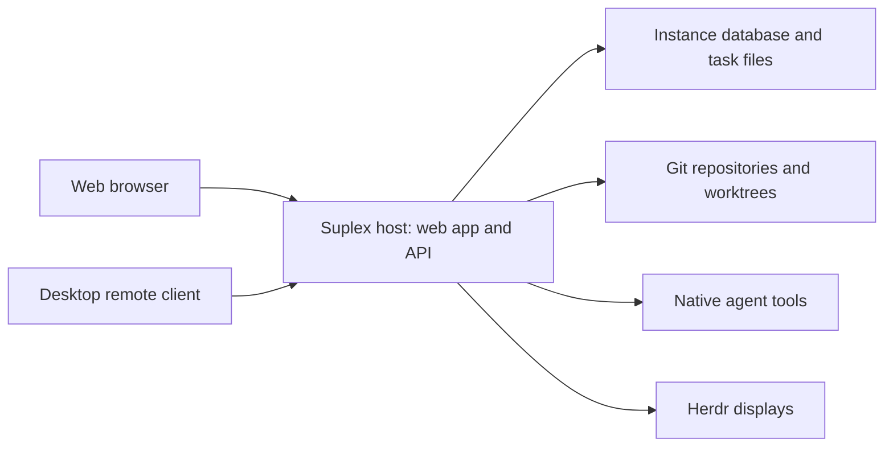

# Instances, clients, and distribution

For contributors and operators choosing where Suplex runs, this page explains
the host/client boundary and the supported distribution paths. Sources:
[host entry point](../../rust/src/main.rs),
[installation configuration](../../rust/src/platform/config.rs),
[desktop boot](../../desktop/src/boot.ts),
[desktop target policy](../../desktop/src/suplex-target.ts),
[binary embedding](../../rust/build.rs), and
[Linux packaging](../../scripts/build-linux.sh).

## One instance owns the work

A Suplex instance is a host installation with its own configuration, SQLite
database, task runtime files, artifacts, and repository/worktree locations.
The Rust server serves the web application and API and runs task coordination.
Native agent tools, Git operations, and Herdr run on that host. The client
presents the interface and sends commands; it does not need a local copy of
the host's repositories or the host's model credentials.

This lets a development server do the work while a laptop connects through a
browser or the desktop app. Closing a browser or remote desktop window does
not stop that independently managed server. The server's availability and task
recovery depend on its host lifecycle, not an open client window.

The connection model is:

The same model applies locally, with the desktop app and host on one Mac. In
local desktop mode, the app additionally installs and supervises its bundled
host. See [runtime ownership](runtime.md) for scheduling and state authorities.

## Local and remote connections

Local access binds to loopback. Desktop **Run locally** uses `127.0.0.1` and
keeps installation data under `~/Library/Application Support/Suplex`. Local
requests receive the built-in Operator session. This is an owner-controlled
host trust model, not isolation from other local processes.

Remote access connects to an existing instance URL. The desktop app installs
nothing on the remote host and does not start or stop that host. The same web
application is available in a browser. Agent executables, sign-ins, project
paths, and integration credentials must be configured on the server where the
work executes, not on each thin client.

The server supports Tailscale Serve HTTPS or a direct Tailscale bind for remote
access. It rejects arbitrary public and LAN bind addresses. The desktop URL
policy accepts HTTPS targets and permits plain HTTP only for loopback targets.
Consequently, a direct Tailscale HTTP endpoint is not an accepted remote desktop
target; use the HTTPS exposure for that client. An HTTPS URL passing desktop
validation does not by itself establish a supported public-server deployment.
See [installation and access](../../README.md#set-up-an-installation).

The desktop Navigate menu remembers instance URLs and lets you switch between
them. Switching changes the instance you view; it does not move tasks, merge
databases, or synchronize credentials. Each instance retains its own state.
Projects and companies are organizational boundaries within an instance, not
separate servers or a distributed worker pool.

## Distribution paths

The repository builds these forms of Suplex:

| Distribution | Contents and execution | Client |
| --- | --- | --- |
| macOS desktop | Electron application with a native host binary and runtime manifest; Apple silicon and Intel builds | Bundled web client for local mode, or a thin client of another instance |
| Linux binary | Architecture-specific `suplex` executable in a versioned tarball, with checksum and download manifest; arm64 and x64 builds | Browser, or a remote desktop client on another machine |
| Source checkout | Frontend build plus native Rust host, with development and supervised installation commands | Browser or desktop URL connection |

The release binary embeds the built frontend assets and SQL migrations. A
standalone host does not need a separate frontend server or Electron to serve
the application. Node, pnpm, and Rust participate in building from source; they
are not a separate JavaScript application server shipped alongside the native
binary. Native providers, Git, and display tools remain host dependencies.
A packaged binary does not bundle or authenticate every agent tool.

Linux packaging uses a Debian-based build environment and produces an
architecture-specific executable, not a universally static binary. Platform
compatibility and authenticated provider execution still require verification
on the destination host. Build scripts establish artifact support, not proof
that a particular version has been published or installed successfully.

## Process ownership and updates

In local desktop mode, the app starts its bundled host and stops the process
group it owns on quit. It can adopt an already running host only when that host
reports the same installation identity. It leaves an adopted host running.
An unrelated server occupying the preferred port causes another local port to
be selected; answering a health check is not enough to claim ownership.

The remote web page is sandboxed in Electron, with Node integration disabled.
Desktop connection, installation, and updater controls belong to the desktop
shell. The remote application does not receive authority to update the client
or run arbitrary client-side tools. A server worktree path also does not imply
that the same path exists on the client. See the README's **Open in** behavior
before changing local-tool launch assumptions.

Desktop updates replace the app and its bundled host together. Checkout hosts
have a separate Git-based update mechanism. Linux archives have their own
publication manifest; that manifest is not an Electron update feed or proof of
an automatic binary updater. See [updates and release publication](../updates.md)
for the existing distribution procedures. Native sessions retain their own
execution state across host recovery; stopping a host is not proof that every
agent child process has finished.

[Architecture index](README.md)
