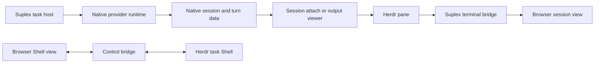

# Herdr architecture

For maintainers diagnosing terminal behavior, this page explains display
attachment, browser transport, and cleanup. Sources:
[task display](../../rust/src/runtimes/task_display.rs),
[pane routes](../../rust/src/http/routes/task_pane.rs),
[terminal bridge](../../rust/src/integrations/herdr_bridge.rs), and
[display cleanup](../../rust/src/tasks/archive/displays.rs).

## Execution and display

The diagram separates execution from display. It does not imply that every
provider wires automatic attachment. See [provider differences](providers.md).

## Host terminals

The Suplex option on the Terminal settings page replaces Herdr for the task
Shell, the session Mirror, and provider sign-in. The Suplex host then runs each terminal in
a PTY that it owns, see [host terminals](../../rust/src/terminals/host.rs). The
host reads the setting for each new connection. Terminal ids come from the task
or session and are not stored. After a restart, the next connection starts a new
terminal. The host closes a task's terminals on archive, and closes terminals
without a viewer when the task is finished. Archive and task completion still
close Herdr panes that the task has, whatever the setting says. Native agent
turns do not change.

## Pane ownership

Suplex manages a workspace labelled
`suplex-<taskId>`, a task Shell, and session panes. It reuses suitable panes or
creates balanced rows. Stored pane IDs narrow discovery; live Herdr observations
determine what exists. Attachment inspects the foreground process before reusing
a pane, so a reused ID cannot justify replacing unrelated work. Labels and
metadata are best-effort display information.

A session attachment records its pane on the session row; the Shell binding is
stored on task controls. Failed attachment does not block native dispatch.
Passive viewers follow a session runtime directory across turns and exit when
that directory, once present, is removed. Closing a display does not cancel
native work.

## Browser connections

Task pane routes expose WebSocket views.
Session panes use read-only observation; the task Shell uses interactive control.
The terminal bridge owns the Herdr
observer/control child for that connection and releases it on disconnect.
Observation begins with a viewport snapshot, follows terminal frames, and
replaces its observer when the pane dimensions change or the child exits.
Browser input, resize, and scroll do not control a session observer. The Shell
control path accepts these operations. Missing or replaced panes cause reconnect
to the current binding, not a task failure.

## Cleanup

Archive display cleanup only signals or
closes panes whose current metadata establishes ownership. Missing or reassigned panes, and retryable Herdr discovery failures, leave the
display alone. Other discovery or cleanup errors can still interrupt archive.
This is a known discrepancy to investigate against the no-mirror-gates rule;
see [unresolved work](unknowns.md). Worktree cleanup has separate
Git/data-preservation decisions.

The [Herdr operations guide](../herdr-integration.md) covers readiness and sidebar
configuration; [HERDR.md](../../HERDR.md) covers contributor use of Herdr. Neither
makes terminal state authoritative for task completion.

[Architecture index](README.md)
