# Forge product guide

Forge is the working name for the operating system of a small, agent-powered
software agency. It is for an established developer moving into independent
work: someone responsible for client relationships and delivery, while using
specialist agents to multiply the amount of good work the agency can carry.

Forge keeps the agency close to its repositories and local tools. It makes the
work visible and durable without asking people to maintain a second, elaborate
project-management ritual. The intended character is premium, capable, direct,
and a little warm. It should never feel like Jira or a dashboard made of clicks
and status cards.

> **Naming note:** Forge is a working name and remains the product name in this
> repository. Lemonade/Lemon is only a possible future name, playing on “ADE”
> for agentic development environment.

## The agency workflow

Create a Forge project from a repository, connect the providers available on
the host, then create a task with the client context and delivery intent. The
task becomes the durable record of the work from intake to completion.

```text
Repository project
        ↓
Provider + profile configuration
        ↓
Task intake and prioritisation
        ↓
backlog → planning → approval → building → reviewing → shipping → done
```

A blocked task keeps its phase and shows one card with the actions that unblock it.

Tasks are available in three complementary views:

- **Task index** for a dense, current list with ownership, status, and items
  that need attention.
- **Kanban** for seeing the flow of active work without making the board a
  drag-and-drop state machine.
- **Timeline** for understanding sequence, deadlines, and how delivery work
  fits together over time.

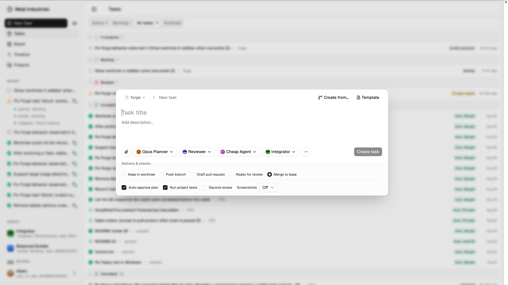


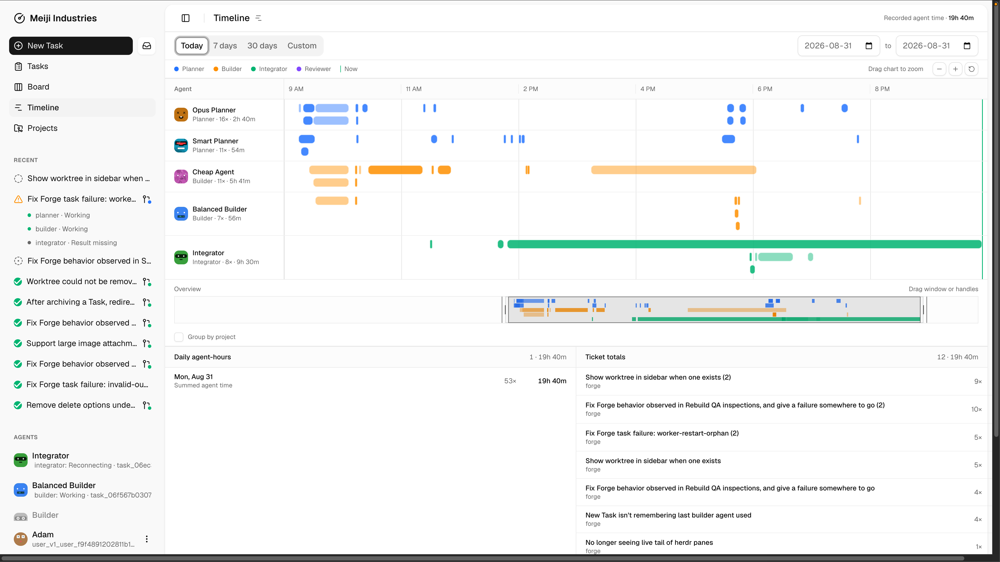

## The task is the workbench

Task detail is Forge’s central workspace. A task should answer, without a hunt:
what is being delivered, who and what is working on it, what decision or action
is next, and whether the evidence is sufficient to ship.

It combines the task brief and plan with live agent and Herdr panes, in-context
chat and pull-request context, activity history, diffs, checks, delivery status,
and a compact property rail. This creates one place to move between judgment,
implementation, and proof.


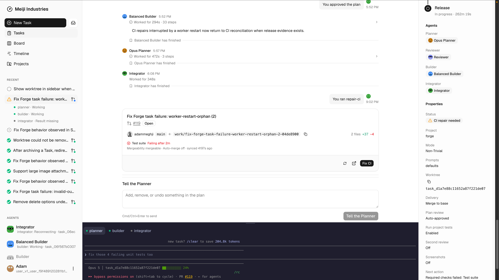

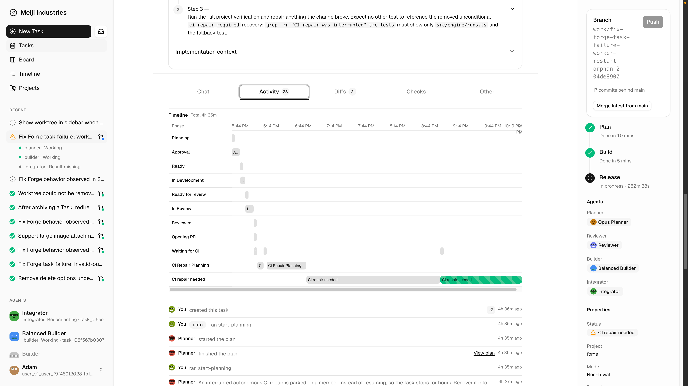

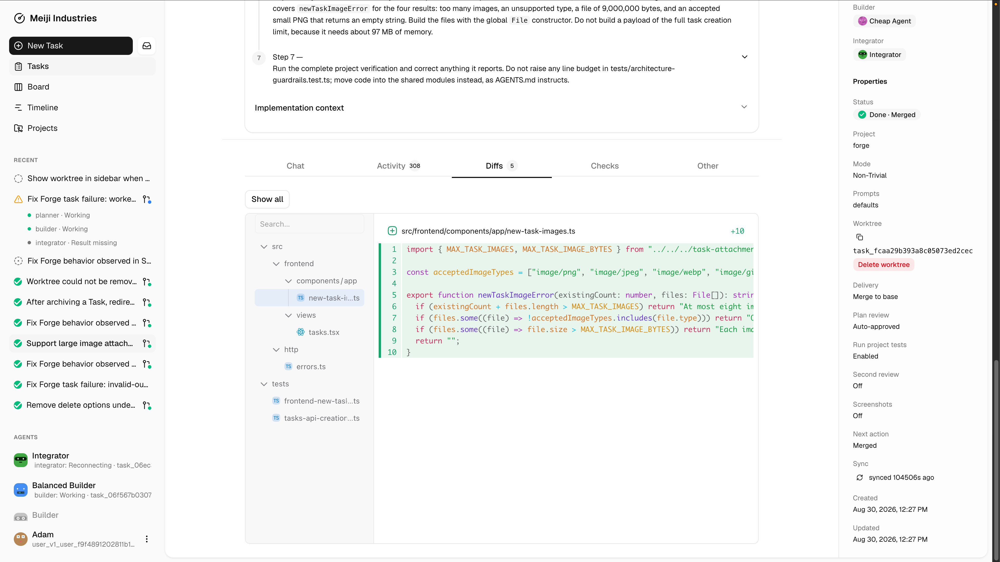

## Roles and agents

Forge makes the roles in an agent-assisted delivery process explicit:

- **Planner** turns client context and repository evidence into an executable
  approach.
- **Reviewer** tests the plan and delivery against acceptance, correctness,
  safety, and operational needs.
- **Builder/developer** makes the prescribed change in an isolated worktree and
  returns concrete verification evidence.
- **Integrator** brings an approved revision through checks, pull request,
  merge, and delivery.

Hermes is a first-class agent in this model. It can participate in Forge and
create tasks from external context when there is work worth bringing into the
agency’s delivery flow.

Agent identity, capacity, provider, model, reasoning level, and priority are
configured deliberately. A role does not silently fall back to an arbitrary
model when its intended profile is unavailable.

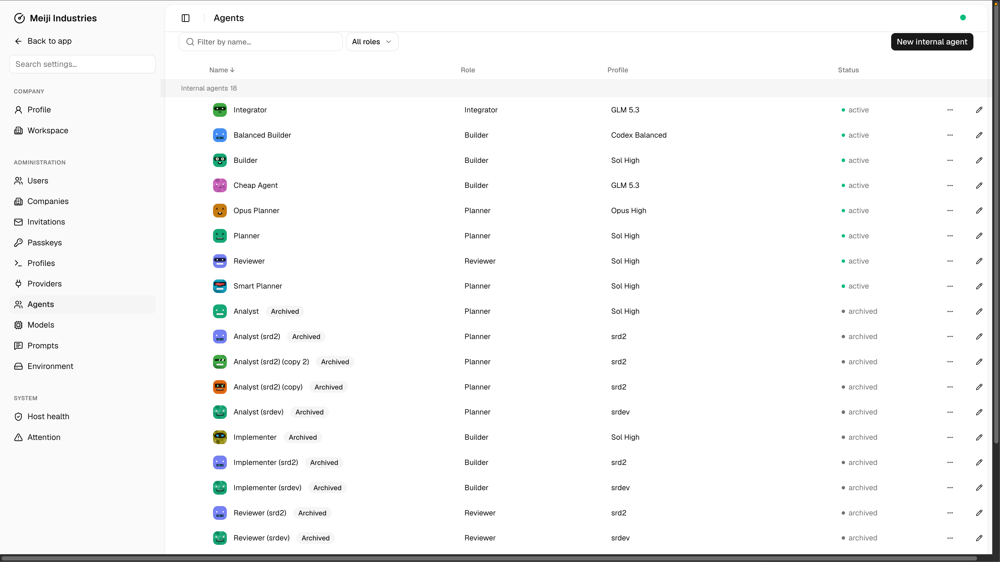

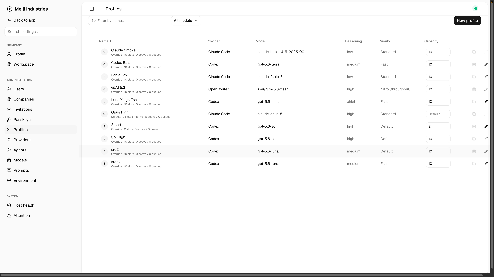

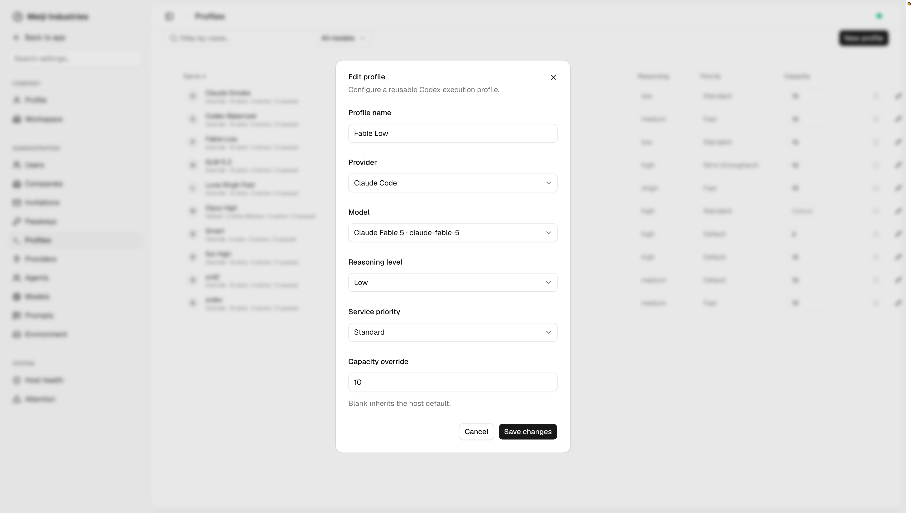

## Agency configuration

Forge configuration is organised around the operating reality of an agency:

- Companies and workspaces, plus users authenticated with passkeys.
- Projects created from repositories and configured for their delivery path.
- Agent profiles and capacity lanes that set how much work each provider can
  safely run.
- Providers and local authentication, a model catalogue, and cascading prompts
  that establish agency, project, and role context.
- Environment configuration and host health, so the people accountable for
  delivery can see whether the local system is ready.

Current provider support is local Codex CLI and Claude Code sessions, with
OpenRouter models run through `omp`. Forge uses existing host logins for Codex
and Claude. An OpenRouter key is stored locally, protected from workflow
history and artifacts, and left out of backups.

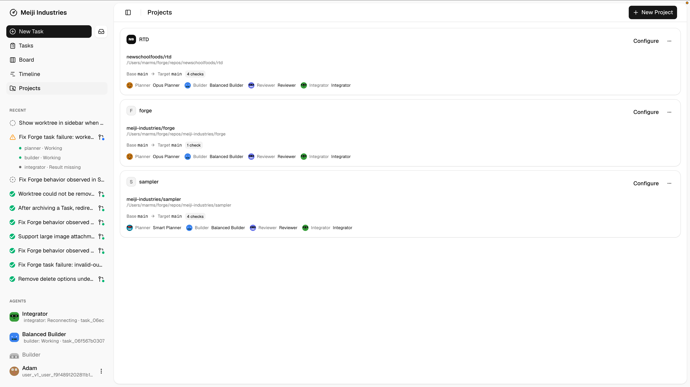

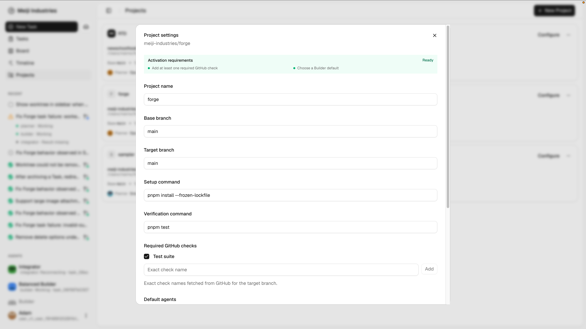


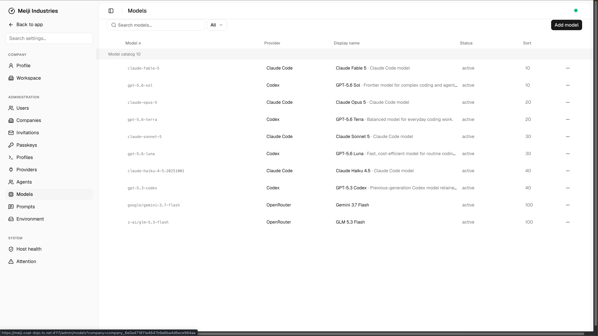

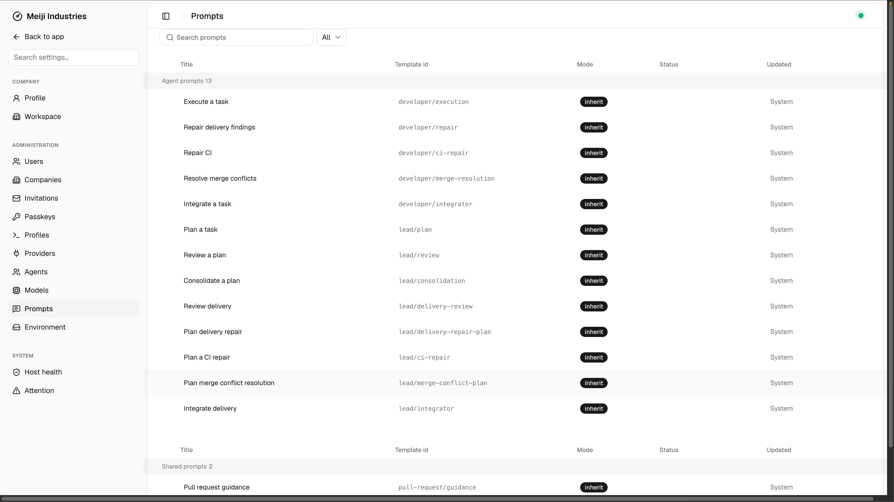

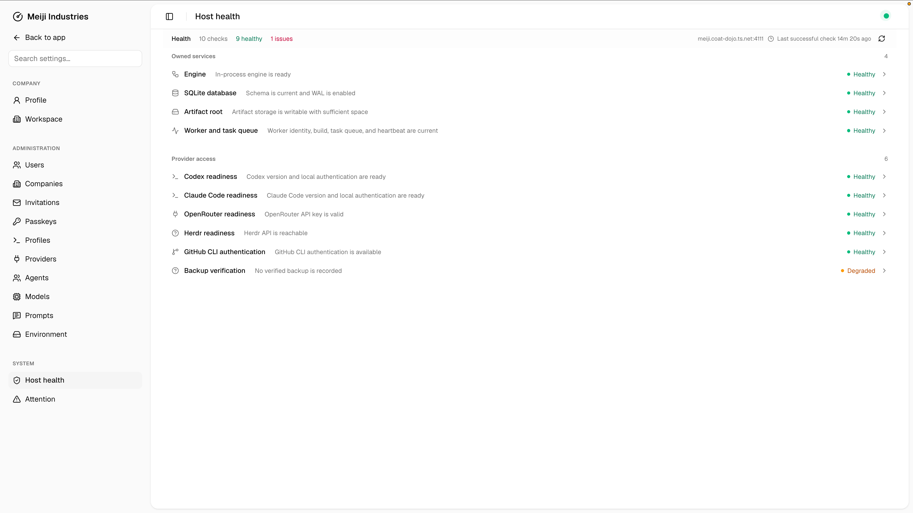

## What Forge has today

Forge already provides the durable operating path behind the interface:

- Repository-backed projects and isolated issue worktrees.
- Task creation, index, Kanban, and timeline views.
- Durable workflow phases for planning, review, development, delivery checks,
  pull requests, merge reconciliation, and completion.
- Task evidence that connects plans, review, activity, diffs, checks, pull
  request state, and delivery receipts.
- Configurable users, companies, projects, agents, profiles, capacity,
  providers, models, prompts, and host readiness.
- Passkey access, local-first data and artifacts, and Tailscale-only service
  exposure for the current operating boundary.

The implementation deliberately keeps workflow state durable and treats the
index, board, and timeline as live views of that work. It records proof rather
than relying on a task being manually moved through an optimistic status board.

## Next design priorities

The next product work is primarily about making the agency’s situation easier
to read at a glance, not adding process for its own sake.

The full design-engagement handoff is available as a [design brief](design-brief.md)
and a portable [HTML design brief](design-brief.html).

### Make task detail easier to scan

Task detail is already the central workspace, but its information hierarchy can
be sharper. The immediate delivery state, next action, key evidence, and
agent activity should be legible before someone needs to inspect every pane.
The work is to make a dense workspace calmer and more decisive, not to simplify
it into a shallow card layout.

### Add a clear needs-you surface

Forge needs a notification inbox, or a focused **needs-you** queue, for the
decisions that genuinely require a person: plan approval, unavailable provider
authentication, capacity exhaustion, a review decision, or final acceptance.
It should separate actionable moments from ordinary work that is safely
waiting or retrying.

### Give the owner a mission-control view

An agency mission-control view should show the agency’s wins, risks, and active
work alongside agent hours. Where useful for the business model, it can also
show billable or retainer progress. This is an operating picture for the agency
owner, not a generic executive dashboard and not a substitute for task detail.

## Design principles

Forge is a dense productivity application. Persistent navigation, compact
toolbars, inline interaction, split panes, and contextual actions should make
it quick to operate. The application should use the available screen and keep
important state in reach. Large marketing treatment, decorative cards, excess
empty space, and ritualised workflows work against the product.

For implementation guidance, see [interface principles](interface-principles.md).
For local setup and the detailed operations model, return to the
[README](../README.md).
